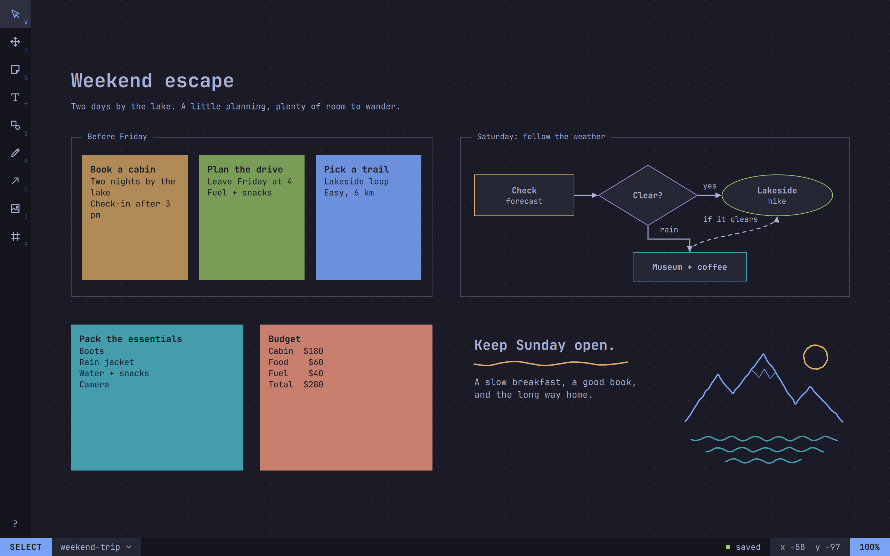
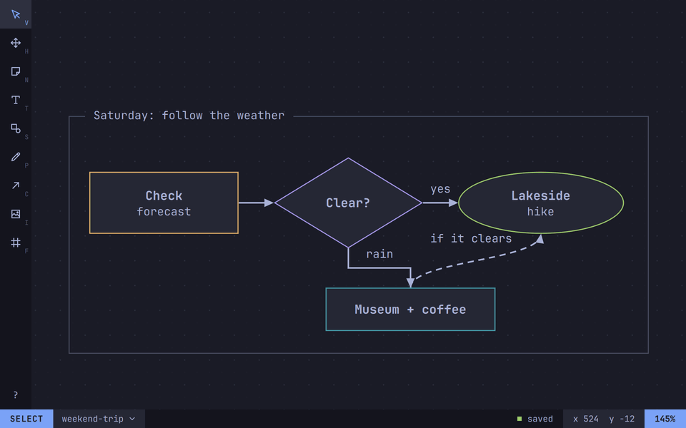
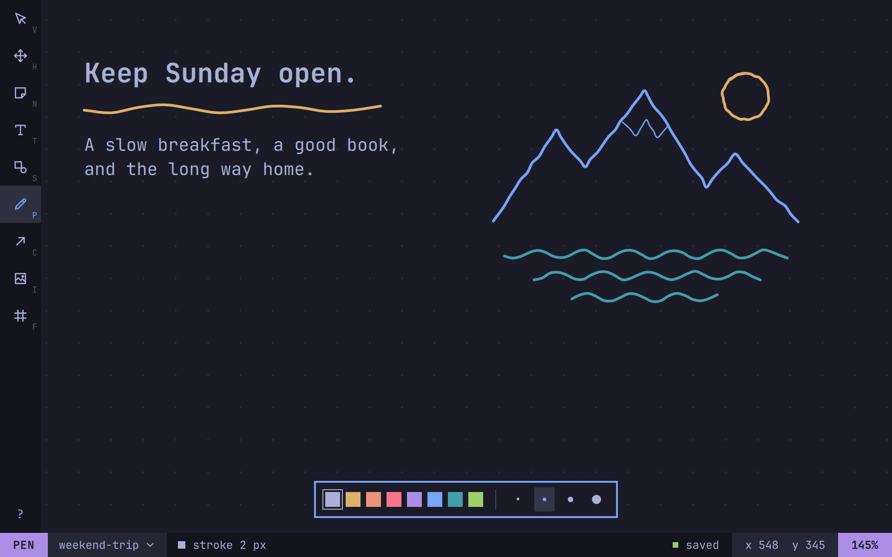
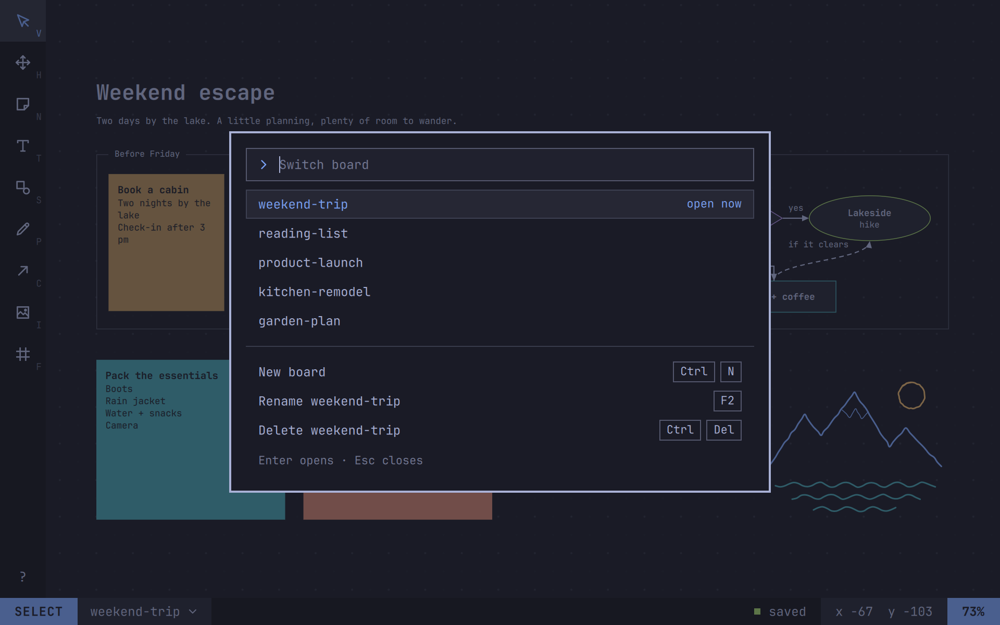
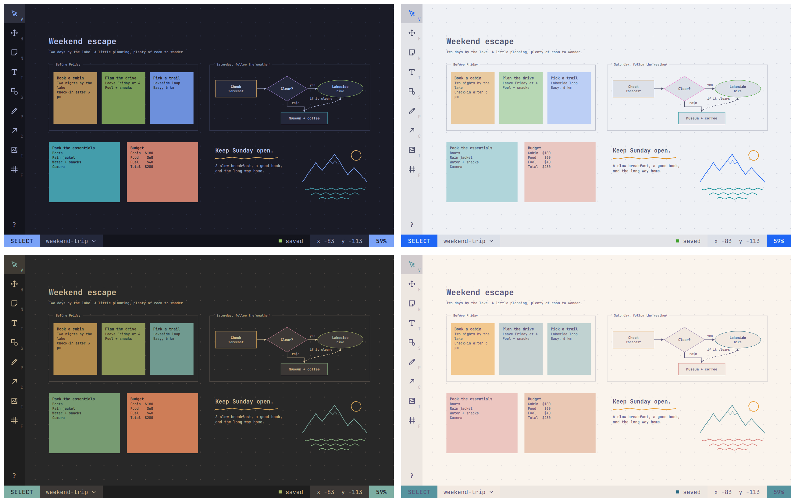

# Sprawl

Sprawl is an infinite canvas for Omarchy: sticky notes, sketches, pictures
and diagrams on a board that never runs out of room. It is driven from the
keyboard, follows your theme, and saves itself. Boards stay on your computer,
and there is no account.

[Install](#install) · [Guide](docs/guide.md) · [Changelog](CHANGELOG.md) · [Releases](https://github.com/willykev/sprawl/releases)



## Features

- **Notes, text and pictures.** `Space` puts a sticky note under the pointer,
  `T` writes text straight on the board, and `I` adds pictures. Paste takes a
  picture or text from anywhere.
- **Diagrams that stay connected.** Nineteen shapes, and connectors that
  follow what they join: straight, curved or elbow; solid, dashed or dotted.
- **A pen.** Sketch freehand in your theme's colors and four widths.
- **Frames and groups.** Gather related things in a titled frame that carries
  what sits inside it. Group, restack and duplicate anything.
- **Nothing to save.** A board is written a moment after every change, and
  every step can be undone.
- **Export.** The whole board or only what is selected, to PNG, SVG or PDF.
- **Looks like your desktop.** Colors, font and corners come from your
  Omarchy theme, light or dark, and change when it does.

## Install

Sprawl runs on Omarchy and Arch Linux, on x86_64 and ARM64.

```sh
git clone https://github.com/willykev/sprawl.git
cd sprawl
bin/install
```

This builds an Arch package and installs it, asking for your password once.
Then open **Sprawl** from the app launcher, or run `sprawl open`.

On ARM64 you can skip the build. Download `sprawl-*-aarch64.pkg.tar.xz` from
the [latest release](https://github.com/willykev/sprawl/releases/latest) and
install it:

```sh
sudo pacman -U sprawl-*-aarch64.pkg.tar.xz
```

On Arch Linux without Omarchy, install what the build needs first:

```sh
sudo pacman -S --needed base-devel git qt6-base qt6-declarative qt6-imageformats qt6-svg qt6-wayland xdg-desktop-portal
```

To update, run `git pull` and `bin/install` again. To remove Sprawl, run
`sudo pacman -R sprawl`; your boards are left where they are.

## Start a board

Press **Space** to put a note under the pointer, type your idea, and press
**Esc**. Drag things to move them, scroll to pan, and hold **Ctrl** while
scrolling to zoom. There is nothing to save.

To look around a finished board first, open the one in these pictures from
the folder you cloned:

```sh
sprawl open examples/weekend-trip
```

### Connect things, and they stay connected

`S` opens the shapes and `C` joins two things with a line. Move either one
and the line follows. A line can carry a label, and each end can be an arrow,
a dot, a diamond or nothing at all.



### Sketch with the pen

`P` draws freehand, and `[` and `]` make the line thinner or thicker.
Strokes are smoothed as you draw and stay sharp where your hand turns a
corner.



### Keep a board for everything

`Ctrl+O` lists your boards. Type a few letters of a name and press
**Enter**. New boards are made, renamed and moved to the trash from the same
place, and each one opens where you left it.



### Change the theme, and Sprawl changes with it

Sprawl has no colors or fonts of its own. Notes, shapes and strokes are
colored by name, so a board takes on each theme's own yellow, blue and green.



### Keys worth knowing

| Key | Does |
| --- | --- |
| `Space` | New note under the pointer |
| `T` / `S` / `P` | Text / shape / pen |
| `C` | Connect two things |
| `I` | Add pictures |
| `F` | Frame |
| `Return` | Edit the text of what is selected |
| `1` / `0` | Fit the whole board / actual size |
| `Ctrl+O` / `Ctrl+N` | Switch boards / new board |
| `Ctrl+E` | Export |
| `Ctrl+Z` / `Ctrl+Shift+Z` | Undo / redo |
| `?` | Show every shortcut |

The [guide](docs/guide.md#shortcuts) lists every key, and what the mouse
does.

## Use the terminal

Every board can be read and changed from the terminal. If the board is open,
the window shows the change at once.

```sh
sprawl new ideas                                   # a new board
sprawl add ideas note --text "Build something small" --color yellow
sprawl add ideas shape --shape diamond --text "Ship it?"
sprawl show ideas                                  # what is on it, and where
sprawl export ideas -o ideas.pdf                   # or .png, or .svg
```

Run `sprawl help` for every command, and add `--json` for scripts.
`sprawl skill install` teaches coding agents to lay out boards for you.

## Performance

- A board of 48,000 items pans, zooms and drags at 118 to 119 frames a
  second on a 120 Hz display.
- From launch to a drawn board takes a third of a second (333 ms).
- Memory use peaks at about 150 MB with the example board open.
- `sprawl export` writes the example board to a PDF in about 50 ms, with no
  window.
- The package is under half a megabyte.

Measured on an Apple M3 Max running Asahi Linux, Hyprland 0.56.2 and Qt 6.12.
Frame rates come from `sprawl open --bench 48000`. Start time and memory come
from timing `sprawl open examples/weekend-trip --screenshot shot.png`, which
starts, draws one frame, saves it and exits.

## Your data

Each board is a folder in `~/.local/share/sprawl/boards/`: a `board.json`
plain enough to write by hand, and an `assets` folder with its pictures. Back
up that folder, or copy a board's folder to another computer.

Sprawl never uses the network. There is no sync, no sharing, and no working
on a board together.

## More

The [guide](docs/guide.md) covers every shortcut and command, the board file
format, and [what Sprawl does not do](docs/guide.md#what-it-does-not-do). See
the [changelog](CHANGELOG.md) for what is new, and
[CONTRIBUTING](CONTRIBUTING.md) to build, test or change Sprawl.

[MIT license](LICENSE), with acknowledgments to the upstream projects.

[](https://github.com/willykev/sprawl/actions/workflows/build.yml)
