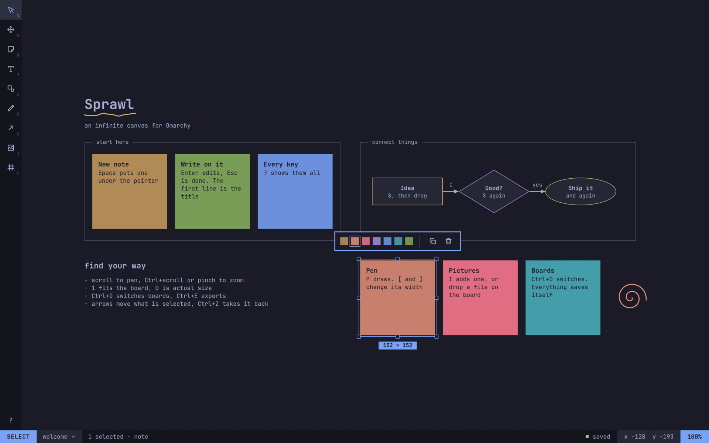

# Sprawl

An infinite canvas for Omarchy. Put your ideas somewhere you can see them:
notes, sketches, pictures, and diagrams on a board that grows with you.

- Write sticky notes and text, draw with the pen, and drop in pictures.
- Build diagrams with shapes and connectors that follow what they join.
- Gather related ideas into frames; move, resize, and group them.
- Save automatically and export a board or selection to PNG, SVG, or PDF.
- Follow your Omarchy theme automatically.

Boards stay on your computer. No account or cloud service is required.

## Install

From the project folder on Omarchy or Arch Linux:

```sh
bin/install
```

This builds and installs the app. Open **Sprawl** from the app launcher, or run
`sprawl open`.

Building requires a C++ compiler, `make`, `qmake6`, and the `qt6-base`,
`qt6-declarative`, `qt6-svg`, and `qt6-wayland` packages. File dialogs use
`xdg-desktop-portal` and your desktop's portal backend.

## Start a board

Press **Space** to add a note under your pointer. Type your idea, then press
**Esc** when you're done. Drag things to move them, scroll to pan, and use
**Ctrl+scroll** to zoom. Your changes save automatically.

| Key | Action |
| --- | --- |
| `Space` | Add a note |
| `T` / `S` / `P` | Text / shape / pen |
| `C` | Connect two items |
| `I` | Add a picture |
| `F` | Add a frame |
| `1` | Fit the whole board |
| `Ctrl+O` / `Ctrl+N` | Switch boards / new board |
| `Ctrl+E` | Export |
| `Ctrl+Z` / `Ctrl+Shift+Z` | Undo / redo |
| `?` | Show every shortcut |

Try the included [weekend trip example](examples/weekend-trip/board.json):

```sh
sprawl open examples/weekend-trip
```

## Use the terminal

```sh
sprawl new ideas
sprawl add ideas note --text "Build something small" --color yellow
sprawl export ideas -o ideas.pdf
```

Run `sprawl help` for all commands. Add `--json` for scripts, or run
`sprawl skill install` to install the bundled agent instructions.

## Your data

Each board lives in `~/.local/share/sprawl/boards/`, with a `board.json` file
and an `assets` folder for pictures. Back up the whole board folder.
Device sync and collaboration are not included.

## Development

```sh
bin/build     # Build into build/sprawl
bin/test      # Run the tests without opening a window
bin/shaders   # Rebuild shaders after editing them; needs qt6-shadertools
```

See the [full guide](docs/guide.md) for all shortcuts, file formats, and
rendering details.

[MIT license](LICENSE), with acknowledgments to the upstream projects.
